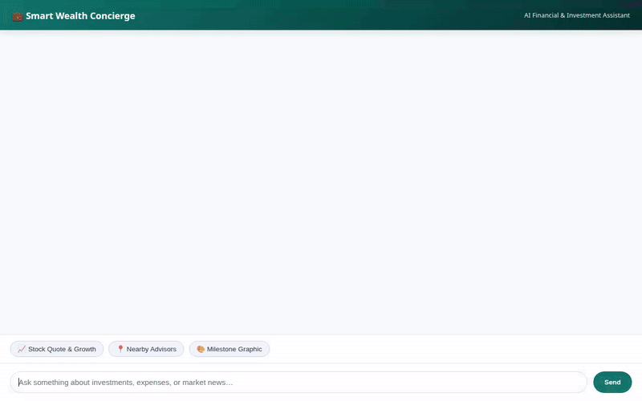

# Smart Wealth Concierge 💰📈

Smart Wealth Concierge is an agentic financial advisor and wealth management assistant built on Google Cloud's Agent Development Kit (ADK), Gemini 2.5 Flash, and Agent Runtime.



---

## Key Features & Tools

### 🧠 Cross-Session Memory Bank
- **Vertex AI Memory Bank**: Remembers user preferences, home locations, and default currencies across conversations so financial advice and branch searches are automatically tailored.

### 💾 Firestore Portfolio & Expense Tracking
- **Portfolio Management**: View asset holdings, quantities, and allocations (`get_portfolio`), or update positions (`add_or_update_holding`).
- **Expense Logging**: Record new financial transactions (`log_transaction`) and query expense history (`get_transactions`) stored in Google Cloud Firestore.

### 📈 Market Intelligence & Projection Tools
- **Stock Market Data**: Real-time simulated stock quotes and valuation metrics for symbols like AAPL, GOOGL, NVDA, and VTI (`get_stock_quote`).
- **Market News**: Real-time headlines fetched via RSS (`fetch_market_news`).
- **Compound Interest Calculator**: Multi-year compound growth projections with detailed yearly breakdowns (`calculate_financial_projection`).
- **Foreign Exchange Rates**: Live FX rates for global currencies (`get_currency_exchange_rates`).

### 🗺️ Location & Branch Discovery
- **Geocoding**: Converts street addresses to geographic coordinates using Google Maps Geocoding API (`geocode_address`).
- **Nearby Places**: Discovers nearby bank branches, ATMs, and wealth advisors using Google Places API (New) (`find_nearby_places`).

### 🎨 Visual & Media Generation
- **Milestone Badges**: Generates goal achievement graphics using `gemini-3.1-flash-lite-image` (`generate_milestone_graphic`), saving artifacts to the Playground and uploading directly to Google Cloud Storage.
- **Financial Video Visualization**: Generates animated videos using Google's Omni model (`gemini-omni-flash-preview`) in the global region (`generate_wealth_video`).

### 🐍 Secure Code Execution
- **Python Sandbox**: Executes complex custom math and data calculations safely inside an `AgentEngineSandboxCodeExecutor`.

### 🖥️ Native A2UI Interface
- **Agent-to-User UI**: Emits structured display cards (Cards, Columns, Rows, Text, Images) rendered dynamically by the custom chat UI.

---

## Project Structure

```
smart-wealth-concierge/
├── app/
│   ├── agent.py                 # Core ADK Agent definition, instruction, tools & callbacks
│   ├── a2ui_utils.py            # A2UI formatting utilities and after_model_callback
│   └── memory_bank_utils.py     # Vertex AI Memory Bank preload and memory generation callbacks
├── frontend/
│   ├── main.py                  # FastAPI proxy communicating with Agent Engine over A2A
│   └── static/
│       ├── index.html           # Rebranded wealth chat interface with prompt chips & A2UI renderer
│       └── css/                 # Custom styling
├── tests/                       # Unit and integration test suite
├── agents-cli-manifest.yaml     # agents-cli deployment manifest
└── pyproject.toml               # Project dependencies and configuration
```

---

## Local Setup & Run Instructions

### Prerequisites
- Python 3.11+
- `uv` package manager (`pip install uv`)
- Authenticated Google Cloud SDK (`gcloud auth login` and `gcloud auth application-default login`)

### 1. Install Dependencies
```bash
uv sync
```

### 2. Run Tests
```bash
uv run pytest
```

### 3. Run the Agent Locally (ADK Web / Playground)
```bash
adk web --app app
```

### 4. Run the Web Frontend
From the `frontend/` directory, set your environment variables and start the server:

```bash
cd frontend
export AGENT_ENGINE_RESOURCE_NAME="projects/<PROJECT_ID>/locations/us-central1/reasoningEngines/<ENGINE_ID>"
export AGENT_DIRECTORY="app"
uv run python main.py
```

Open a web browser and navigate to port `8080` on `localhost` to interact with the chat interface.

---

## Deployment Instructions

Deploy the agent to Google Cloud Agent Runtime using `agents-cli`:

```bash
agents-cli deploy
```

Deploy the FastAPI frontend proxy to Google Cloud Run:

```bash
cd frontend
gcloud run deploy smart-wealth-frontend \
  --source . \
  --region us-central1 \
  --allow-unauthenticated \
  --set-env-vars AGENT_ENGINE_RESOURCE_NAME="projects/<PROJECT_ID>/locations/us-central1/reasoningEngines/<ENGINE_ID>",AGENT_DIRECTORY="app"
```
